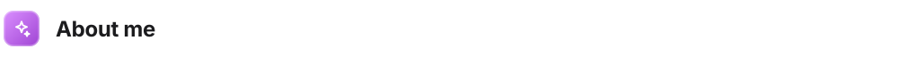
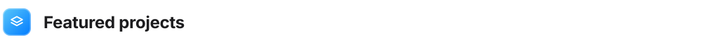
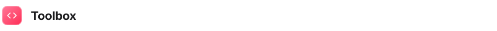
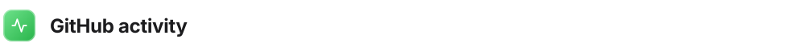

<!--
  Glass design system · every card below is a static SVG in /assets
  (wide + phone sizes, light + dark — picked automatically by the visitor's screen and theme).
  Edit text or colours in .github/scripts/build_cards.py, then run:  python3 .github/scripts/build_cards.py
  The stats card refreshes daily via .github/workflows/stats.yml
-->

<a href="https://abdelrahmanelsayedouf.github.io/Abdelrahman-Portofolio/"><picture>
  <source media="(max-width: 640px) and (prefers-color-scheme: dark)" srcset="assets/header-m-dark.svg" />
  <source media="(max-width: 640px)" srcset="assets/header-m-light.svg" />
  <source media="(prefers-color-scheme: dark)" srcset="assets/header-dark.svg" />
  
</picture></a>

  <a href="https://abdelrahmanelsayedouf.github.io/Abdelrahman-Portofolio/"><picture><source media="(prefers-color-scheme: dark)" srcset="assets/link-portfolio-dark.svg" /></picture></a>
  <a href="https://www.linkedin.com/in/abdelrahman-ouf"><picture><source media="(prefers-color-scheme: dark)" srcset="assets/link-linkedin-dark.svg" /></picture></a>
  <a href="mailto:abd-elrahman_elsayed@outlook.com"><picture><source media="(prefers-color-scheme: dark)" srcset="assets/link-email-dark.svg" /></picture></a>
  <a href="https://wa.me/201006892802"><picture><source media="(prefers-color-scheme: dark)" srcset="assets/link-whatsapp-dark.svg" /></picture></a>

<picture>
  <source media="(max-width: 640px) and (prefers-color-scheme: dark)" srcset="assets/label-about-m-dark.svg" />
  <source media="(max-width: 640px)" srcset="assets/label-about-m-light.svg" />
  <source media="(prefers-color-scheme: dark)" srcset="assets/label-about-dark.svg" />
  
</picture>

<picture>
  <source media="(max-width: 640px) and (prefers-color-scheme: dark)" srcset="assets/about-m-dark.svg" />
  <source media="(max-width: 640px)" srcset="assets/about-m-light.svg" />
  <source media="(prefers-color-scheme: dark)" srcset="assets/about-dark.svg" />
  
</picture>

<picture>
  <source media="(max-width: 640px) and (prefers-color-scheme: dark)" srcset="assets/label-projects-m-dark.svg" />
  <source media="(max-width: 640px)" srcset="assets/label-projects-m-light.svg" />
  <source media="(prefers-color-scheme: dark)" srcset="assets/label-projects-dark.svg" />
  
</picture>

<a href="https://github.com/AbdelrahmanElsayedOuf/Belkhimah"><picture>
  <source media="(max-width: 640px) and (prefers-color-scheme: dark)" srcset="assets/project-belkhedma-m-dark.svg" />
  <source media="(max-width: 640px)" srcset="assets/project-belkhedma-m-light.svg" />
  <source media="(prefers-color-scheme: dark)" srcset="assets/project-belkhedma-dark.svg" />
  
</picture></a>

<a href="https://github.com/AbdelrahmanElsayedOuf/E-Invoicing"><picture>
  <source media="(max-width: 640px) and (prefers-color-scheme: dark)" srcset="assets/project-einvoicing-m-dark.svg" />
  <source media="(max-width: 640px)" srcset="assets/project-einvoicing-m-light.svg" />
  <source media="(prefers-color-scheme: dark)" srcset="assets/project-einvoicing-dark.svg" />
  
</picture></a>

<a href="https://github.com/AbdelrahmanElsayedOuf/MindMission-eLearning-WebAPI"><picture>
  <source media="(max-width: 640px) and (prefers-color-scheme: dark)" srcset="assets/project-mindmission-m-dark.svg" />
  <source media="(max-width: 640px)" srcset="assets/project-mindmission-m-light.svg" />
  <source media="(prefers-color-scheme: dark)" srcset="assets/project-mindmission-dark.svg" />
  
</picture></a>

<a href="https://www.tphgroup.me/home"><picture>
  <source media="(max-width: 640px) and (prefers-color-scheme: dark)" srcset="assets/project-tph-m-dark.svg" />
  <source media="(max-width: 640px)" srcset="assets/project-tph-m-light.svg" />
  <source media="(prefers-color-scheme: dark)" srcset="assets/project-tph-dark.svg" />
  
</picture></a>

<picture>
  <source media="(max-width: 640px) and (prefers-color-scheme: dark)" srcset="assets/label-toolbox-m-dark.svg" />
  <source media="(max-width: 640px)" srcset="assets/label-toolbox-m-light.svg" />
  <source media="(prefers-color-scheme: dark)" srcset="assets/label-toolbox-dark.svg" />
  
</picture>

<picture>
  <source media="(max-width: 640px) and (prefers-color-scheme: dark)" srcset="assets/toolbox-m-dark.svg" />
  <source media="(max-width: 640px)" srcset="assets/toolbox-m-light.svg" />
  <source media="(prefers-color-scheme: dark)" srcset="assets/toolbox-dark.svg" />
  
</picture>

<picture>
  <source media="(max-width: 640px) and (prefers-color-scheme: dark)" srcset="assets/label-activity-m-dark.svg" />
  <source media="(max-width: 640px)" srcset="assets/label-activity-m-light.svg" />
  <source media="(prefers-color-scheme: dark)" srcset="assets/label-activity-dark.svg" />
  
</picture>

<picture>
  <source media="(max-width: 640px) and (prefers-color-scheme: dark)" srcset="assets/stats-m-dark.svg" />
  <source media="(max-width: 640px)" srcset="assets/stats-m-light.svg" />
  <source media="(prefers-color-scheme: dark)" srcset="assets/stats-dark.svg" />
  
</picture>

<a href="mailto:abd-elrahman_elsayed@outlook.com"><picture>
  <source media="(max-width: 640px) and (prefers-color-scheme: dark)" srcset="assets/footer-m-dark.svg" />
  <source media="(max-width: 640px)" srcset="assets/footer-m-light.svg" />
  <source media="(prefers-color-scheme: dark)" srcset="assets/footer-dark.svg" />
  
</picture></a>
