<!-- Glass design system: every card is a static SVG in /assets (wide + phone, light + dark).
     The links row and the projects grid are each ONE glass panel cut into clickable slices (align="top" tiles them seamlessly).
     Edit scripts/build_cards.py and run `python3 scripts/build_cards.py` to rebuild.
     Keep this file as ONE html block: no blank lines, and no spaces between the slices of a section. -->

<picture><source media="(max-width: 640px) and (prefers-color-scheme: dark)" srcset="assets/header-m-dark.svg" /><source media="(max-width: 640px)" srcset="assets/header-m-light.svg" /><source media="(prefers-color-scheme: dark)" srcset="assets/header-dark.svg" />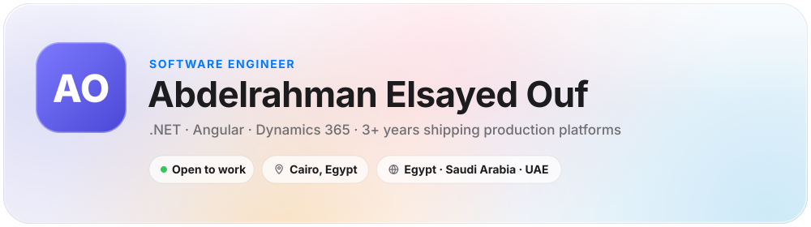</picture>
<a href="https://abdelrahmanelsayedouf.github.io/Abdelrahman-Portofolio/"><picture><source media="(max-width: 640px) and (prefers-color-scheme: dark)" srcset="assets/link-portfolio-m-dark.svg" /><source media="(max-width: 640px)" srcset="assets/link-portfolio-m-light.svg" /><source media="(prefers-color-scheme: dark)" srcset="assets/link-portfolio-dark.svg" /></picture></a><a href="https://www.linkedin.com/in/abdelrahman-ouf"><picture><source media="(max-width: 640px) and (prefers-color-scheme: dark)" srcset="assets/link-linkedin-m-dark.svg" /><source media="(max-width: 640px)" srcset="assets/link-linkedin-m-light.svg" /><source media="(prefers-color-scheme: dark)" srcset="assets/link-linkedin-dark.svg" />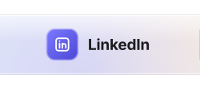</picture></a><a href="mailto:abd-elrahman_elsayed@outlook.com"><picture><source media="(max-width: 640px) and (prefers-color-scheme: dark)" srcset="assets/link-email-m-dark.svg" /><source media="(max-width: 640px)" srcset="assets/link-email-m-light.svg" /><source media="(prefers-color-scheme: dark)" srcset="assets/link-email-dark.svg" /></picture></a><a href="https://wa.me/201006892802"><picture><source media="(max-width: 640px) and (prefers-color-scheme: dark)" srcset="assets/link-whatsapp-m-dark.svg" /><source media="(max-width: 640px)" srcset="assets/link-whatsapp-m-light.svg" /><source media="(prefers-color-scheme: dark)" srcset="assets/link-whatsapp-dark.svg" /></picture></a>
<picture><source media="(max-width: 640px) and (prefers-color-scheme: dark)" srcset="assets/about-m-dark.svg" /><source media="(max-width: 640px)" srcset="assets/about-m-light.svg" /><source media="(prefers-color-scheme: dark)" srcset="assets/about-dark.svg" />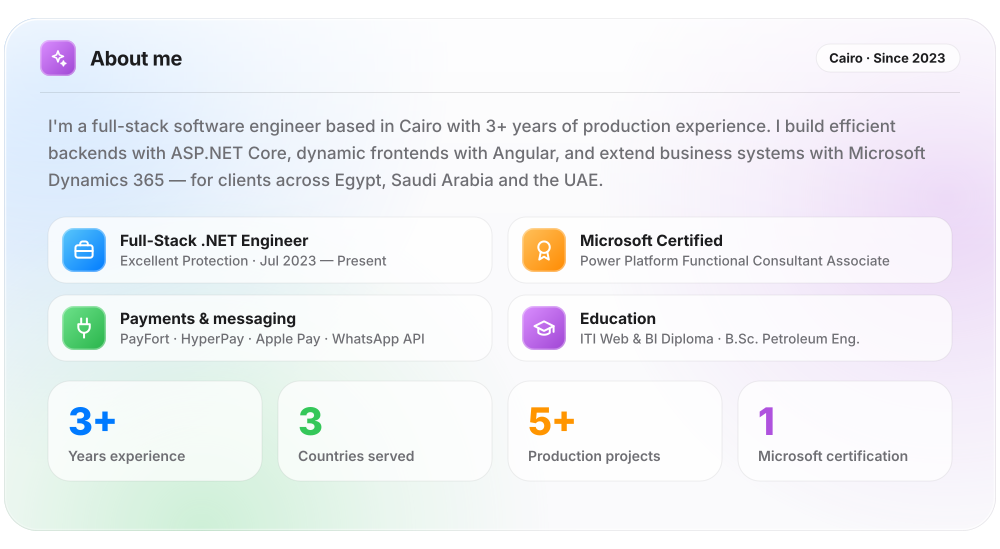</picture>
<a href="https://github.com/AbdelrahmanElsayedOuf/?tab=repositories"><picture><source media="(max-width: 640px) and (prefers-color-scheme: dark)" srcset="assets/project-head-m-dark.svg" /><source media="(max-width: 640px)" srcset="assets/project-head-m-light.svg" /><source media="(prefers-color-scheme: dark)" srcset="assets/project-head-dark.svg" />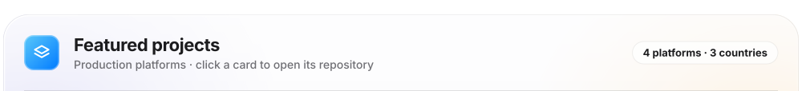</picture></a><a href="https://github.com/AbdelrahmanElsayedOuf/Belkhimah"><picture><source media="(max-width: 640px) and (prefers-color-scheme: dark)" srcset="assets/project-belkhedma-m-dark.svg" /><source media="(max-width: 640px)" srcset="assets/project-belkhedma-m-light.svg" /><source media="(prefers-color-scheme: dark)" srcset="assets/project-belkhedma-dark.svg" />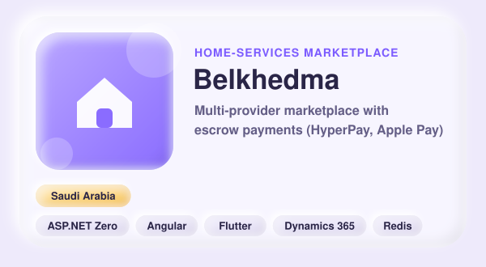</picture></a><a href="https://github.com/AbdelrahmanElsayedOuf/E-Invoicing"><picture><source media="(max-width: 640px) and (prefers-color-scheme: dark)" srcset="assets/project-einvoicing-m-dark.svg" /><source media="(max-width: 640px)" srcset="assets/project-einvoicing-m-light.svg" /><source media="(prefers-color-scheme: dark)" srcset="assets/project-einvoicing-dark.svg" />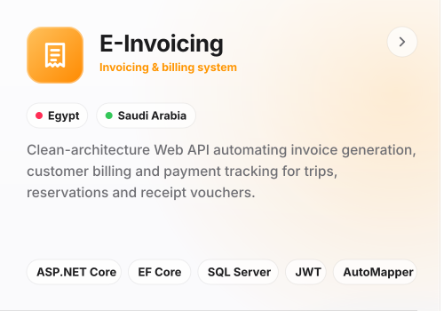</picture></a><a href="https://www.tphgroup.me/home"><picture><source media="(max-width: 640px) and (prefers-color-scheme: dark)" srcset="assets/project-tph-m-dark.svg" /><source media="(max-width: 640px)" srcset="assets/project-tph-m-light.svg" /><source media="(prefers-color-scheme: dark)" srcset="assets/project-tph-dark.svg" />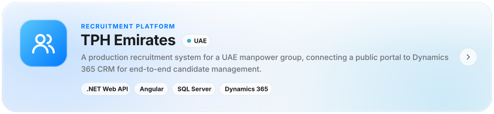</picture></a><a href="https://github.com/AbdelrahmanElsayedOuf/MindMission-eLearning-WebAPI"><picture><source media="(max-width: 640px) and (prefers-color-scheme: dark)" srcset="assets/project-mindmission-m-dark.svg" /><source media="(max-width: 640px)" srcset="assets/project-mindmission-m-light.svg" /><source media="(prefers-color-scheme: dark)" srcset="assets/project-mindmission-dark.svg" />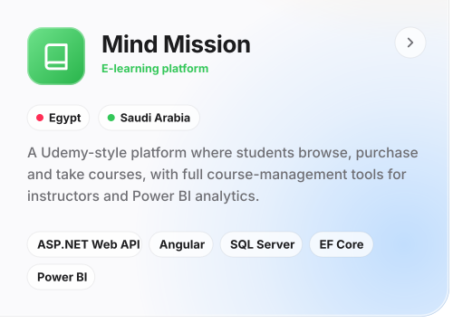</picture></a>
<picture><source media="(max-width: 640px) and (prefers-color-scheme: dark)" srcset="assets/toolbox-m-dark.svg" /><source media="(max-width: 640px)" srcset="assets/toolbox-m-light.svg" /><source media="(prefers-color-scheme: dark)" srcset="assets/toolbox-dark.svg" />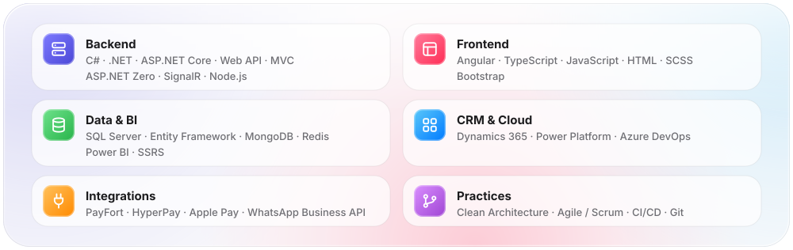</picture>
<picture><source media="(max-width: 640px) and (prefers-color-scheme: dark)" srcset="assets/stats-m-dark.svg" /><source media="(max-width: 640px)" srcset="assets/stats-m-light.svg" /><source media="(prefers-color-scheme: dark)" srcset="assets/stats-dark.svg" />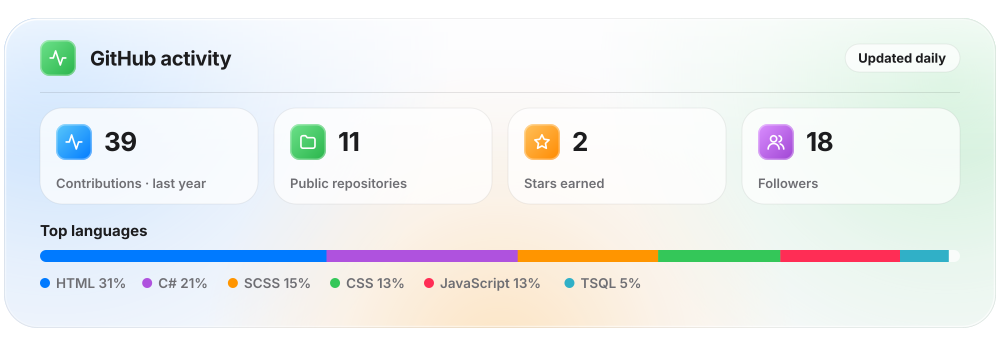</picture>
<a href="mailto:abd-elrahman_elsayed@outlook.com"><picture><source media="(max-width: 640px) and (prefers-color-scheme: dark)" srcset="assets/footer-m-dark.svg" /><source media="(max-width: 640px)" srcset="assets/footer-m-light.svg" /><source media="(prefers-color-scheme: dark)" srcset="assets/footer-dark.svg" />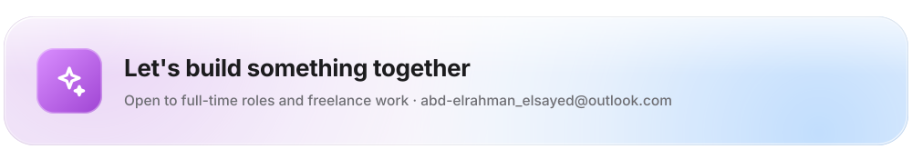</picture></a>

